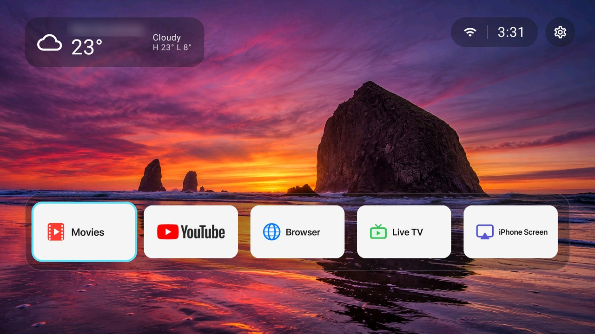

**English** · [Русский](README.ru.md) · [中文](README.zh-CN.md)

# Divan

A light, ad-free home screen for Android TV and Google TV, made for weak boxes such as the Chromecast with Google TV (HD). No accounts, no tracking, no purchases.



## Features

- **One row of apps** with banners: reorder (move left/right, to the start or the end), hide, change the banner, uninstall — all from a long press on OK.
- **Your own banners**: drop `<package>.png` into `Pictures/Divan/icons` on the TV; `<package>.en.png`, `<package>.ru.png`, `<package>.zh.png` follow the interface language. A ready set in the Apple SF Symbols style is in [`banners/`](banners).
- **Content rows** under the apps: *Up Next* and the channels apps publish (YouTube, IPTV and movie apps), switchable per app and per channel. Posters are cached and prefetched, so scrolling stays smooth.
- **Weather** in the corner (Open-Meteo, no key): the city is found by Wi-Fi location, then IP, then the time zone, and is kept stable — a coarse fix never renames a city found by a precise one.
- **Remote buttons remapping** (accessibility service): single, double and long press; open an app or a link, Home, Back, volume, media keys, power menu and more; in all apps, only on the home screen or everywhere but it.
- **Power**: an app to open when the TV turns on, and a switch that keeps the TV awake.
- **Notifications** bell and list on the home screen.
- **Wallpapers** from `Pictures/Wallpapers`, two themes, adjustable row height.
- **Three languages**: English, Russian, Simplified Chinese — follows the system or set in *Appearance → Language*.

Built for weak hardware: flat translucent panels, no blur or shadows, one full-screen layer, measured frame times on a Chromecast HD.

## Requirements

- Android TV / Google TV, Android 12 (API 31) or newer.
- No root. Installation needs `adb` once.

## Build and install

```bash
./gradlew :app:assembleRelease
adb install -r app/build/outputs/apk/release/app-release.apk
adb shell pm grant com.rdsinteractive.divan android.permission.READ_EXTERNAL_STORAGE
adb shell pm grant com.rdsinteractive.divan android.permission.ACCESS_COARSE_LOCATION
adb shell pm grant com.rdsinteractive.divan android.permission.READ_TV_LISTINGS
# ahead-of-time compile: without it scrolling is noticeably slower until Android gets to it
adb shell cmd package compile -m speed -f com.rdsinteractive.divan
```

Then press Home on the remote and choose Divan, or make it the default home app:

```bash
adb shell cmd package set-home-activity com.rdsinteractive.divan/.MainActivity
```

On Google TV the stock launcher may take Home back; disabling it (`pm disable-user com.google.android.apps.tv.launcherx`) is up to you and reversible with `pm enable`.

Optional, in Android settings: turn on the accessibility service *Divan: remote buttons* for remapping, and notification access for the bell.

> Do not `am force-stop` Divan: Android then switches its accessibility service off and it has to be turned on again by hand.

## Banners

```bash
python3 tools/make_banners.py out en   # macOS: SF Pro / Hiragino fonts and rsvg-convert (brew install librsvg)
adb push out/. /sdcard/Pictures/Divan/icons/
```

## Privacy

Divan goes online only for the weather (Open-Meteo), the city name (Android geocoder, ipwho.is) and the posters of the content rows. Nothing else leaves the TV.

## License

[MIT](LICENSE)
