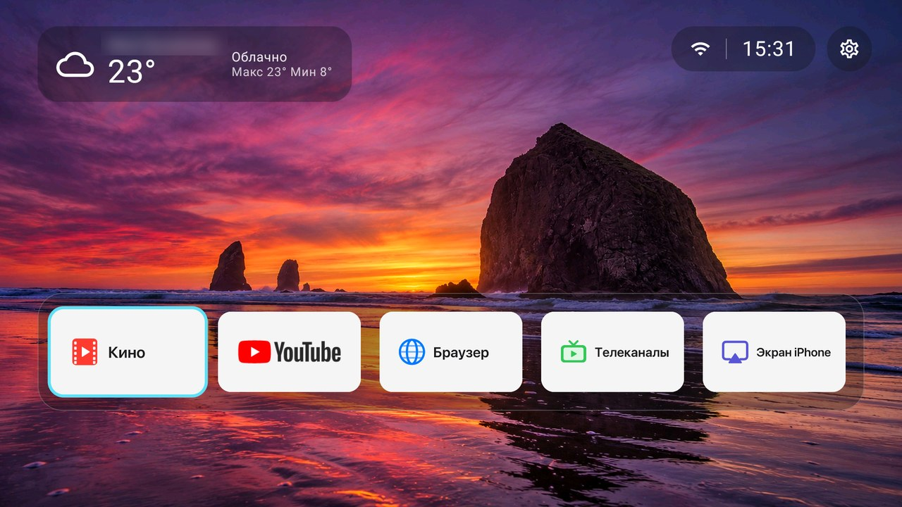

[English](README.md) · **Русский** · [中文](README.zh-CN.md)

# Divan

Лёгкий главный экран для Android TV и Google TV без рекламы, рассчитанный на слабые приставки вроде Chromecast with Google TV (HD). Без аккаунтов, слежки и покупок.



## Возможности

- **Один ряд приложений** с баннерами: сдвинуть влево или вправо, сделать первым или последним, убрать, сменить баннер, удалить — долгим нажатием ОК.
- **Свои баннеры**: положите `<пакет>.png` в `Pictures/Divan/icons` на ТВ; `<пакет>.en.png`, `<пакет>.ru.png`, `<пакет>.zh.png` меняются вместе с языком. Готовый набор в стиле Apple SF Symbols — в [`banners/`](banners).
- **Ряды под приложениями**: «Смотреть далее» и каналы, которые выкладывают приложения (YouTube, IPTV, кинотеатры); включаются по приложению и по каналу. Обложки кешируются и загружаются заранее, прокрутка не дёргается.
- **Погода** в углу (Open-Meteo, без ключа): город определяется по Wi-Fi, затем по IP, затем по часовому поясу и не прыгает — грубое определение не переименует город, найденный точным.
- **Переназначение кнопок пульта** (служба спецвозможностей): одиночное, двойное и долгое нажатие; открыть приложение или ссылку, «Домой», «Назад», громкость, медиакнопки, меню питания и другое; во всех приложениях, только на главном экране или везде, кроме него.
- **Питание**: приложение при включении ТВ и выключатель «Не засыпать при простое».
- **Уведомления**: колокольчик и список на главном экране.
- **Обои** из `Pictures/Wallpapers`, две темы, высота ряда настраивается.
- **Три языка**: английский, русский, китайский (упрощённый) — как в системе или в «Оформление → Язык».

Сделан под слабое железо: плоские полупрозрачные панели, без размытия и теней, один полноэкранный слой; время кадра замерено на Chromecast HD.

## Требования

- Android TV / Google TV, Android 12 (API 31) и новее.
- Root не нужен. Для установки один раз нужен `adb`.

## Сборка и установка

```bash
./gradlew :app:assembleRelease
adb install -r app/build/outputs/apk/release/app-release.apk
adb shell pm grant com.rdsinteractive.divan android.permission.READ_EXTERNAL_STORAGE
adb shell pm grant com.rdsinteractive.divan android.permission.ACCESS_COARSE_LOCATION
adb shell pm grant com.rdsinteractive.divan android.permission.READ_TV_LISTINGS
# заранее скомпилировать: без этого прокрутка заметно медленнее, пока Android не сделает это сам
adb shell cmd package compile -m speed -f com.rdsinteractive.divan
```

Затем нажмите «Домой» на пульте и выберите Divan или назначьте его главным экраном:

```bash
adb shell cmd package set-home-activity com.rdsinteractive.divan/.MainActivity
```

На Google TV штатный лаунчер может забирать «Домой» обратно. Выключить его (`pm disable-user com.google.android.apps.tv.launcherx`) — на ваше усмотрение, вернуть можно через `pm enable`.

По желанию, в настройках Android: включите службу спецвозможностей «Divan: кнопки пульта» для переназначения и доступ к уведомлениям для колокольчика.

> Не делайте `am force-stop` Divan: Android при этом выключает его службу спецвозможностей, и включать её придётся вручную.

## Баннеры

```bash
python3 tools/make_banners.py out ru   # macOS: шрифты SF Pro / Hiragino и rsvg-convert (brew install librsvg)
adb push out/. /sdcard/Pictures/Divan/icons/
```

## Приватность

Divan выходит в интернет только за погодой (Open-Meteo), названием города (геокодер Android, ipwho.is) и обложками рядов. Больше ничего не покидает ТВ.

## Лицензия

[MIT](LICENSE)
